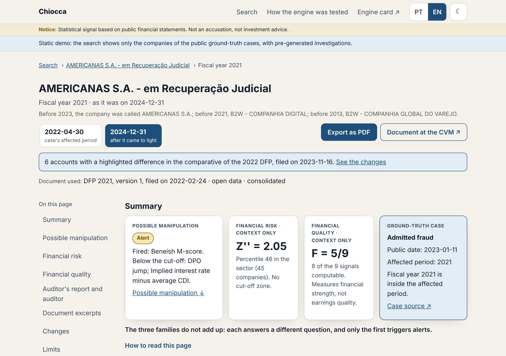
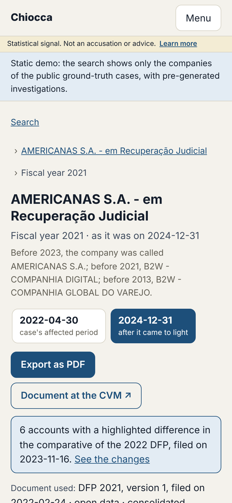

<div align="center">

# Chiocca System

**Accounting-manipulation alerts for Brazilian listed companies, computed only from what was public at the time.**

[Português](README.md) · [Demo](https://robertochiocca.github.io/Chiocca-System-/)

</div>

> **Alert, not accusation.** Study and portfolio project: the system issues statistical alerts from public financial statements and is not investment advice. An alert says where to look, not that fraud occurred.

## In 30 seconds

Chiocca System computes accounting-manipulation signals (the Beneish M-score and Brazil-specific signals) for Brazilian listed companies, from CVM open data.
Every calculation uses only the filing version that was public on the date, and the alert rules were fixed before looking at the data.
For a company and a date, the product shows the investigation as it was on that date, with the source of every figure.

<p> </p>

**Study 1 (2010 to 2023), with the rules fixed before the data:** the engine detected 7 of 13 detectable cases, against 7.37 expected by chance; alert rate of 49.9% of evaluated non-financial company-years; 108.3 false alarms per detected case, against 26.8 for the naive rule, which detected 6 ([results](docs/en/results.md)).

**Study 2 (2024 and 2025):** list sealed on 2026-11-21; secondary evaluation from 2027-05-31 and primary from 2030-01-01 ([pre-registration](docs/en/study-2-preregistration.md)).

**Stack:** Python 3.12+ (pandas, DuckDB, FastAPI), Next.js with TypeScript and GitHub Actions; open data from the CVM and Banco Central.

**Demo:** [robertochiocca.github.io/Chiocca-System-](https://robertochiocca.github.io/Chiocca-System-/).

## The problem

The CVM (Brazil's securities regulator) updates its open-data base when a company restates its financial statements. Downloading Americanas' 2021 balance sheet today returns the corrected figure: the R$544 million profit became a R$6.2 billion loss in the restatement. Testing a detector on restated numbers means "predicting" the fraud with the answer in hand. Here, every calculation uses only the version that was public at the cut-off date, and the question is: would simple signals have flagged real cases before they came to light, and at what cost in false alarms?

## Demo

[https://robertochiocca.github.io/Chiocca-System-/](https://robertochiocca.github.io/Chiocca-System-/) is a static site, with no API, holding investigations generated beforehand by the product itself: the 32 ground-truth companies included in demo mode, on fixed dates (the cut-off date of each fiscal year of the affected period, the one of the previous fiscal year and 2024-12-31), in PT and EN, with the PDF. Search is only by name, CVM code or CNPJ. It does not show other companies, other dates or fiscal years from 2024 onward, reserved for study 2.

## First-version signals

Beneish M-score (eight indices that compare one year with the previous one), jump in days payable outstanding (the supplier-finance mechanism in the Americanas case), implied interest too high for the reported debt, earnings not backed by cash and, for financial companies only, the share of non-recurring gains. Formulas, DFP accounts and references are in [`catalogo_sinais.yaml`](catalogo_sinais.yaml), the single source of signals.

## Project status

### Software correctness

The automated tests (pytest) run in CI on Python 3.12 and 3.13. The invariant reproduces study 1 from the temporal store: 9,474 of 9,474 company-years equal to the study, column by column ([temporal storage](docs/en/temporal-storage.md)). The worked example checks every formula against hand-calculated values (`data/exemplo_resolvido.json`), and the quality checks test the CVM data itself ([data checks](docs/en/data-checks.md)). This shows that the software computes what the pre-registration prescribes and reproduces study 1.

### Detection effectiveness

In study 1, the engine detected 7 of 13 detectable cases, with 108.3 false alarms per detected case over the whole period and an alert rate of 49.9% of evaluated non-financial company-years ([summary](docs/summary.md)). The [engine card](docs/en/engine-card.md) brings these figures together with the test against chance, the intended use and what is out of scope.

**After the result (descriptive analysis, not pre-registered).** With independent years, chance would produce 8.56 detections on average, and 7 or more with a probability of 90.0%. Since alerts repeat at the same company (73.8% of non-financial company-years in alert were also in alert in the previous year, against an alert rate of 49.9% of evaluated non-financial company-years), this number is a ceiling. With each case's chance measured on companies in the same group, without assuming independent years, chance would produce 7.37 detections, and 7 or more with a probability of 69.3%. Details in [`docs/en/post-study-1-analyses.md`](docs/en/post-study-1-analyses.md).

One does not prove the other: correct software does not make the alerts right, and a detection does not show that the calculation is correct. Correctness is checked by the tests; effectiveness only by the study, with a ground truth and a pre-registration.

The product (v2) and the history of the phases, from study 1 to study 2's sealed list, are in [`docs/en/history.md`](docs/en/history.md).

## Limitations

Study 1's limitations are in the [summary](docs/summary.md) and the [results](docs/en/results.md). The main ones:

- The implied interest rate alone accounts for 59.8% of non-financial company-years in alert (2,001 of 3,345): finance costs (3.06.02) include exchange differences, lease interest and other items that are not interest on borrowings ([summary](docs/summary.md)).
- The M-score had no value in 1,548 of 6,938 company-years; in 1,306, DEPI was missing. The most common reason is a cash flow statement with no depreciation line in section 6.01.01 (1,135 company-years); when depreciation is combined with amortization in the same line, the total is used and DEPI is computed ([results](docs/en/results.md)).
- The M-score cut-off of -1.78 comes from Beneish (1999), estimated with US companies, and was not recalibrated for Brazil ([summary](docs/summary.md)).
- IRB cannot be detected with annual DFPs (amendment 3); catching it would require quarterly data (ITR) ([summary](docs/summary.md)).
- Few cases: 13 detectable out of 42 in the ground truth, none of them financial ([summary](docs/summary.md)).
- The number of detections did not beat chance in the descriptive test done after the result: 7 detections, against 7.37 expected without assuming independent years (8.56 assuming independent years) ([analysis](docs/en/post-study-1-analyses.md)).
- Old versions recovered from ENET exist only for consolidated statements: from 2010 to 2023, 190 company-years whose point-in-time version had individual statements only were left out (amendment 8) ([temporal storage](docs/en/temporal-storage.md)).
- After the result, the data checks found 57 company-years in which an unfilled balance sheet entered the calculation as zero; 29 alerts depend on it. No ground-truth case was affected. Details in the [later note](docs/en/post-study-1-analyses.md), section 4.

## Principles

Point-in-time (no calculation uses information published after the cut-off date); pre-registration signed before the data ([`docs/pre-registro.md`](docs/pre-registro.md)); no hand-typed numbers; no list of flagged companies is released, only aggregate figures and the ground-truth cases, which are already public; a bad result is still a result; PT and EN with the same numbers, tested.

## How to run

```
python -m pip install -r requirements-lock.txt && python -m pip install -e . --no-deps
python -m pytest                      # offline tests
```

To see the demo on your computer, `make demo` (Node.js 22 or later): it serves the interface at `http://127.0.0.1:3000/` with the versioned examples in `docs/exemplos/` (Americanas, fiscal year 2021, on 2022-04-30 and 2024-12-31), without downloading anything from the CVM and with no API. The full demo is at the link at the top.

The study 1 invariant (9,474 of 9,474 company-years equal to the study) runs locally, with the CVM data in `data/brutos` and the store built by `python -m chiocca.v2.armazem`. CI does not have that data and skips 9 tests: 5 depend on the store (the 2021 invariant and the regeneration of the 4 examples in `docs/exemplos/`) and 4 are phase 2 values of the reference test, left for later.

The full commands (CVM download, base, signals, API, interface and static demo) and the repository structure are in [`docs/en/how-to-reproduce.md`](docs/en/how-to-reproduce.md). Besides the development branch, there are the generated branches `gh-pages` (the demo site) and `estudo-2-dados` (the CVM files used in study 2); to clone only the code, `git clone --single-branch --branch main <repository address>`.

## How this project was built

Conceived, specified and reviewed by Roberto Chiocca, who owns the question, the methodology and the study decisions. The code was written with AI coding assistants, in phases, with a review stop before each phase. The worked example was computed by a separate script, written before the engine, and the modules reused from other projects have their origin in [`docs/origem-do-codigo.md`](docs/origem-do-codigo.md).

## References

Beneish (1999), *The Detection of Earnings Manipulation*; Beneish, Lee and Nichols (2013); Dechow, Ge, Larson and Sloan (2011); Schilit, Perler and Engelhart (2018), *Financial Shenanigans*; Bao et al. (2020). Full list, with pages, DOI and license: [`docs/en/references.md`](docs/en/references.md).
