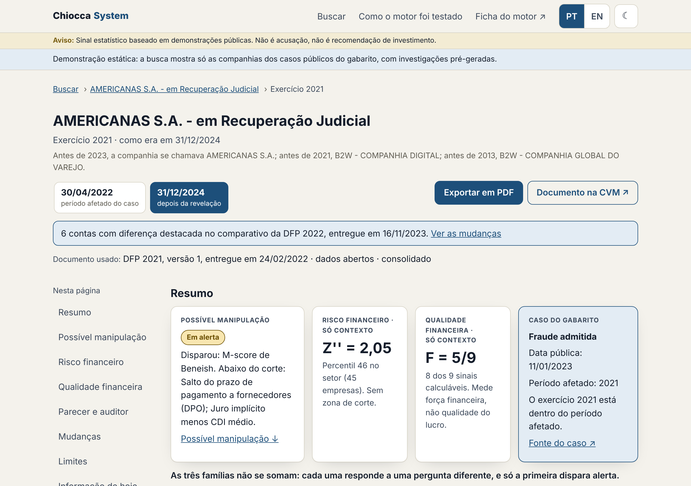
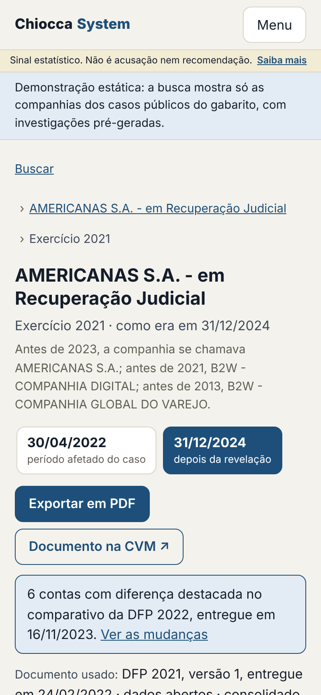
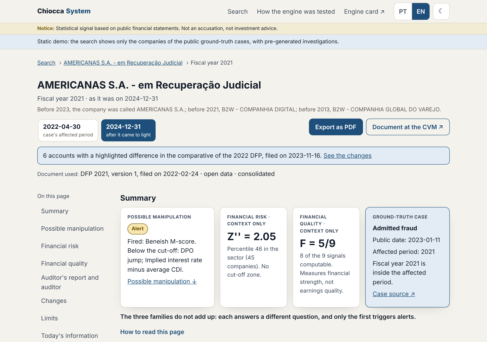
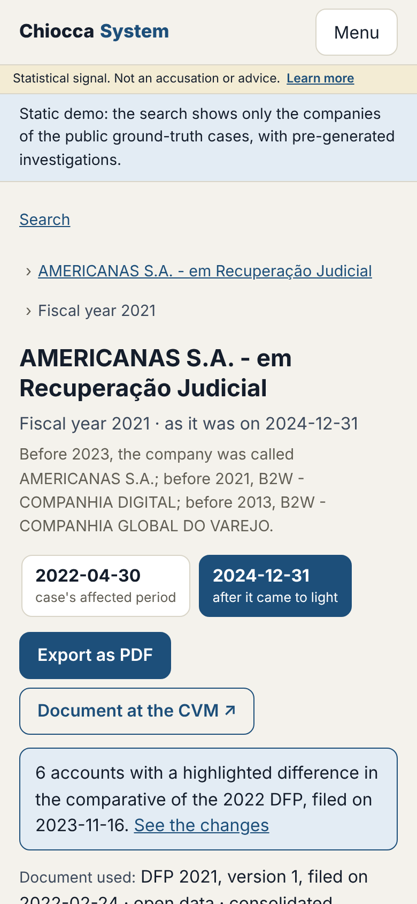

<div align="center">

# Chiocca System

**Alertas de manipulação contábil em companhias abertas brasileiras, calculados só com o que era público na época.**

**Accounting-manipulation alerts for Brazilian listed companies, computed only from what was public at the time.**

[Português](#português) · [English](#english)

*Projeto bilíngue: todo o conteúdo existe completo em português e em inglês.*
*Bilingual project: all content is complete in both Portuguese and English.*

</div>

---

## Português

> **Projeto de estudo e portfólio. Não é acusação nem recomendação de investimento.** O sistema emite alertas estatísticos a partir de demonstrações públicas. Um alerta diz onde olhar, não que houve fraude.

### O problema

Fraudes contábeis grandes costumam deixar rastro nos números antes de virem a público. A pergunta deste projeto é quanto desse rastro dá para ver de fora, só com dados abertos, e a que custo:

> *Com os dados que eram públicos na época, sinais simples teriam alertado para casos reais de manipulação antes de eles virem a público? E quantos alarmes falsos isso custaria?*

O "na época" é o ponto central. A base de dados abertos da CVM é atualizada quando uma empresa reapresenta suas demonstrações. Quem baixa hoje o balanço de 2021 da Americanas pode receber o número já corrigido: o lucro de R$ 544 milhões daquele ano virou prejuízo de R$ 6,2 bilhões na reapresentação ([demonstrações de 2022](https://api.mziq.com/mzfilemanager/v2/d/347dba24-05d2-479e-a775-2ea8677c50f2/a0a24676-9552-a96e-80b1-b5c6a7a90e46?origin=1)). Testar um detector com o número corrigido é "prever" a fraude olhando a resposta. Aqui, cada cálculo usa só a versão que já era pública na data de corte.

### Como funciona

```
Dados abertos da CVM (DFP, todas as versões, incluindo empresas canceladas)
        ↓
Base "como era na época": a versão pública em cada data de corte
        ↓
Sinais do catálogo: M-score de Beneish e sinais adaptados ao Brasil
        ↓
Regras de alerta fixadas no pré-registro, antes de olhar os dados
        ↓
Avaliação: casos reais acertados, alarmes falsos, comparação com uma regra simples
        ↓
Ficha de alerta: qual sinal disparou, com qual número e de qual conta da DFP
```

### Demonstração

**[robertochiocca.github.io/Chiocca-System-](https://robertochiocca.github.io/Chiocca-System-/)**: site estático, sem API, com as investigações geradas antes pelo próprio produto.

- **O que mostra:** as 32 companhias do gabarito que entram no modo demonstração (os casos públicos com data pública, sem os casos em observação), em datas fixas: a data de corte de cada exercício do período afetado do caso, a do exercício anterior e 31/12/2024. Em cada data, a investigação completa como era naquela data, em PT e EN, com o PDF. A busca é só por nome, código CVM ou CNPJ, e o seletor só oferece as datas geradas.
- **O que não mostra:** outras companhias, outras datas nem exercícios de 2024 em diante (reservados ao estudo 2). O produto completo, com qualquer companhia e qualquer data dentro do lacre, roda localmente com a API (veja [Como reproduzir](#como-reproduzir)).

<p> </p>

### Sinais da primeira versão

- **M-score de Beneish:** oito índices que comparam um ano com o anterior.
- **Salto no prazo de fornecedores:** dívida com banco registrada como "fornecedores" alonga o prazo de pagamento. Foi o mecanismo do risco sacado na Americanas.
- **Juro implícito:** despesa financeira alta demais para a dívida declarada pode indicar financiamento fora da linha de empréstimos.
- **Lucro que não vira caixa:** a diferença entre lucro e caixa operacional.
- **Peso de ganhos não recorrentes (só financeiras):** quanto do resultado vem de outras receitas operacionais. Bancos e seguradoras formam um grupo à parte, avaliado só por este sinal, porque os outros não se aplicam a eles.

Fórmulas, contas da DFP e referências de cada sinal, inclusive os das próximas fases, estão em [`catalogo_sinais.yaml`](catalogo_sinais.yaml). O código lê esse arquivo, que é a fonte única dos sinais, com nome e descrição nos dois idiomas.

### Casos de referência

O gabarito ([`data/gabarito_casos.csv`](data/gabarito_casos.csv)) guarda casos reais, cada um com o período afetado, a data em que veio a público, a fonte e se o caso é acertável na análise principal. Ele foi ampliado pelas emendas 6 a 9 do pré-registro com processos sancionadores da CVM; casos sem decisão final ficam em [`data/casos_em_observacao.csv`](data/casos_em_observacao.csv). Os dois casos de partida:

- **Americanas (2023):** revelado por dentro. O Comitê Independente confirmou contratos fictícios de verba de propaganda e operações de risco sacado lançadas em "fornecedores" ([fato relevante de 16/07/2024](https://api.mziq.com/mzfilemanager/v2/d/347dba24-05d2-479e-a775-2ea8677c50f2/fbd1eb14-1e3f-f8ef-ecc5-f49db62d1b04?origin=1)).
- **IRB Brasil (2020):** revelado de fora, pela tese de uma gestora de que o lucro recorrente era menor que o contábil ([InfoMoney](https://www.infomoney.com.br/?p=1397142)). Como é resseguradora, fica fora do M-score, que não se aplica a empresas financeiras, e é avaliado pelo peso de ganhos não recorrentes.

### Princípios

1. **Como era na época.** Nenhum cálculo usa informação posterior à data de corte.
2. **Pré-registro.** Pontos de corte e regras de alerta são decididos e assinados em [`docs/pre-registro.md`](docs/pre-registro.md) antes de qualquer dado. Mudar uma regra depois exige um pré-registro novo.
3. **Nenhum número digitado à mão.** Todo resultado publicado sai de script, e um teste falha se o documento divergir.
4. **Alerta, não acusação.** O repositório publica só números agregados e os casos do gabarito, que já são públicos. Nenhuma lista de empresas em alerta é divulgada.
5. **Resultado ruim também é resultado.** Se o detector não ganhar de uma regra simples, isso vai para o resumo.
6. **Bilíngue de verdade.** Resultados, resumos e fichas de alerta saem do mesmo cálculo em português e em inglês, com teste de números idênticos. A terminologia segue o [`glossario_pt_en.yaml`](glossario_pt_en.yaml).

### Estado do projeto

#### Correção do software

Os testes automáticos (pytest) rodam no CI em Python 3.12 e 3.13. O invariante reproduz o estudo 1 a partir do armazém temporal: 9.474 de 9.474 empresa-anos iguais ao estudo, coluna por coluna ([armazenamento temporal](docs/armazenamento-temporal.md)). O exemplo resolvido confere cada fórmula contra valores calculados à mão (`data/exemplo_resolvido.json`), e as conferências de qualidade testam os próprios dados da CVM ([conferências](docs/conferencias.md)). Isso mostra que o software calcula o que o pré-registro manda e reproduz o estudo 1.

#### Efetividade da detecção

No estudo 1, o motor acertou 7 de 13 casos acertáveis, com 108,3 alarmes por acerto no período inteiro e taxa de alerta de 49,9% das empresa-anos não financeiras avaliadas ([resumo](docs/resumo.md)). A [ficha do motor](docs/ficha-do-motor.md) reúne esses números, o teste contra o acaso, o uso pretendido e o que fica fora de escopo.

**Estudo da primeira versão concluído.** O resumo de uma página está em [`docs/resumo.md`](docs/resumo.md), e os números completos, inclusive o caso a caso do gabarito, a regra boba lado a lado, as análises secundárias e a robustez, em [`docs/resultados.md`](docs/resultados.md). Qualquer mudança de regra ou estudo novo depende de autorização.

**Depois do resultado (análise descritiva, não pré-registrada).** Com anos independentes, o acaso daria 8,56 acertos em média, e 7 ou mais com chance de 90,0%. Como os alertas se repetem na mesma empresa (73,8% das empresa-anos em alerta das não financeiras também estavam em alerta no ano anterior, contra taxa de alerta de 49,9% das empresa-anos não financeiras avaliadas), esse número é um teto. Com a chance de cada caso medida nas empresas do mesmo grupo, sem supor anos independentes, o acaso daria 7,37 acertos, e 7 ou mais com chance de 69,3%. Detalhes em [`docs/analises-pos-estudo-1.md`](docs/analises-pos-estudo-1.md).

Uma coisa não prova a outra: o software estar correto não faz os alertas acertarem, e um acerto não mostra que o cálculo está certo. A correção é conferida pelos testes; a efetividade, só pelo estudo, com gabarito e pré-registro.

#### Produto v2

**Chiocca System v2, do estudo ao produto (em andamento).** O estudo 1 está congelado no branch `estudo-1-final`, e o produto usa o motor v1 como está. Fase A concluída: inventário do código da Carchuna, da Calahonda e do DireitoAberto ([`docs/inventario.md`](docs/inventario.md)), contratos de dados ([`docs/contratos.md`](docs/contratos.md)), plano das fases B a F ([`docs/plano-v2.md`](docs/plano-v2.md)) e lacre dos exercícios de 2024 em diante (`chiocca/v2/lacre.py`), reservados ao estudo 2. Fase B concluída: validade, conferências dos dados da CVM, linhagem e confiança ([`docs/motor-de-confianca.md`](docs/motor-de-confianca.md)), com o resultado das conferências na base inteira em [`docs/conferencias.md`](docs/conferencias.md), e CI no GitHub Actions. Fase C1 concluída: armazenamento temporal (DuckDB sobre Parquet), motor v1 em qualquer data de referência e o invariante do estudo 1 ([`docs/armazenamento-temporal.md`](docs/armazenamento-temporal.md)). Fase C2 concluída: escala original, evidências do contrato, busca no ENET por comando separado, contexto (percentis, histórico, Altman Z'' e Piotroski F, sem alerta), parecer e auditor, a seção "Limites" e a investigação em JSON e PDF, com dois exemplos da Americanas (exercício 2021, em 30/04/2022 e em 31/12/2024) em [`docs/exemplos/`](docs/exemplos/). Fase D concluída: API em FastAPI (`/api/v1`), com contratos em Pydantic, busca só por nome, código CVM ou CNPJ, em ordem alfabética, e nenhuma lista de empresas ordenada por alerta, percentil ou escore ([`docs/contratos.md`](docs/contratos.md), seção 6). Fase E concluída: interface em `web/` (Next.js), em PT e EN, com modo escuro e celular, aviso fixo em todas as telas, comparação com o setor só agregada e a página "Como o motor foi testado" ([`docs/contratos.md`](docs/contratos.md), seção 7); modo demonstração ligado por configuração. Demonstração estática preparada: as investigações do modo demonstração geradas por script, em JSON e PDF, para a interface rodar como site estático, sem API (seção 7 dos contratos). Nada foi publicado: o deploy é decisão de Roberto.

| Implementado | Roadmap |
| --- | --- |
| Catálogo de 16 sinais, em PT e EN, com fórmulas e referências | Dados trimestrais (ITR), necessários para alcançar o IRB |
| Gabarito ampliado e casos em observação, com fontes e notas em PT e EN | |
| Reconhecimento dos dados da CVM ([`docs/reconhecimento.md`](docs/reconhecimento.md)) | |
| Download com verificação por hash e base "como era na época" ([`docs/base.md`](docs/base.md)) | |
| Fórmulas dos sinais da primeira versão, conferidas pelo teste de referência | |
| Sinais e alertas na amostra inteira e métricas do pré-registro ([`docs/resultados.md`](docs/resultados.md)) | |
| CDI do Banco Central (SGS 4389) com fonte registrada ([`docs/fontes.md`](docs/fontes.md)) | |
| Duas leituras da Americanas, robustez com valores neutros, secundária da emenda 5 e análise descritiva rotulada | |
| Ficha de alerta em PT e EN (`python -m chiocca.ficha`) e resumo de uma página ([`docs/resumo.md`](docs/resumo.md)) | |
| Glossário PT↔EN dos termos contábeis e do estudo | |
| Pré-registro do estudo | Ficha de alerta e resumo de uma página, em PT e EN |
| Exemplo resolvido com valores esperados (teste de referência) | |
| Especificação para o agente de código ([`PROMPT.md`](PROMPT.md)) | Próximas fases: auditoria, ganhos não recorrentes a partir das notas explicativas, rendimento do caixa, dividendos sem caixa, F-score e teste de retorno das ações |

### Limitações

As limitações do estudo 1 estão no [resumo](docs/resumo.md) e nos [resultados](docs/resultados.md). As principais:

- O juro implícito responde sozinho por 59,8% das empresa-anos não financeiras em alerta (2.001 de 3.345): a despesa financeira (3.06.02) inclui variação cambial, juros de arrendamento e outros itens que não são juros dos empréstimos ([resumo](docs/resumo.md)).
- O M-score ficou sem valor em 1.548 de 6.938 empresa-anos; em 1.306, faltou o DEPI. O motivo mais comum é a DFC sem linha de depreciação na seção 6.01.01 (1.135 empresa-anos); quando a depreciação vem somada à amortização na mesma linha, o total é usado e o DEPI é calculado ([resultados](docs/resultados.md)).
- O corte de -1,78 do M-score vem de Beneish (1999), estimado com empresas dos EUA, e não foi recalibrado para o Brasil ([resumo](docs/resumo.md)).
- O IRB não pode ser acertado com DFP anual (emenda 3); pegá-lo exigiria dados trimestrais (ITR) ([resumo](docs/resumo.md)).
- Poucos casos: 13 acertáveis em 42 no gabarito, nenhum deles financeiro ([resumo](docs/resumo.md)).
- O número de acertos não superou o acaso no teste descritivo feito depois do resultado: 7 acertos, contra 7,37 esperados sem supor anos independentes (8,56 supondo anos independentes) ([análise](docs/analises-pos-estudo-1.md)).
- Versões antigas recuperadas pelo ENET só existem para demonstrações consolidadas: de 2010 a 2023, 190 empresa-anos com a versão da época só em demonstração individual ficaram de fora (emenda 8) ([armazenamento temporal](docs/armazenamento-temporal.md)).
- Depois do resultado, as conferências acharam 57 empresa-anos em que um balanço não preenchido entrou no cálculo como zero; 29 alertas dependem disso. Nenhum caso do gabarito foi afetado. Detalhes na [nota posterior](docs/analises-pos-estudo-1.md), seção 4.

### Como este projeto foi feito

O Chiocca System foi concebido, especificado e revisado por Roberto Chiocca. A pergunta de pesquisa, a metodologia e as decisões do estudo são dele: o pré-registro foi assinado antes de qualquer dado, cada emenda foi aprovada por ele com data e commit, e o resultado foi publicado como saiu, inclusive o que não funcionou.

O código foi escrito com assistentes de IA para programação, trabalhando por fases a partir de especificação escrita, com parada obrigatória para revisão antes de cada fase seguinte. Nenhum número depende da palavra de ninguém: o exemplo resolvido tem o hash travado no teste, e seus valores foram calculados por um script separado (tests/referencia/gerar_exemplo_resolvido.py), escrito antes do motor e sem importar o pacote; o motor reproduz esses valores no teste de referência. As duas implementações partem da mesma especificação: a conferência pega erro de implementação, não erro na especificação. Mais de cem testes automáticos rodam no CI, e um teste garante que os documentos em português e em inglês têm os mesmos números.

Os módulos reaproveitados de outros projetos do autor (Carchuna, Calahonda e DireitoAberto) foram adaptados ao formato do Chiocca e têm a origem registrada em [docs/origem-do-codigo.md](docs/origem-do-codigo.md).

### Estrutura

```
catalogo_sinais.yaml      sinais: fórmula, contas da DFP, referências, fase (PT e EN)
glossario_pt_en.yaml      termos contábeis e do estudo, PT ↔ EN
data/gabarito_casos.csv   casos reais com datas, fontes, notas (PT e EN) e se são acertáveis
data/casos_em_observacao.csv  casos sem decisão final ou de fronteira (emenda 8)
data/manifesto_brutos.csv  URL, tamanho e SHA256 de cada arquivo baixado da CVM
chiocca/                  código: download, base "como era na época", sinais e avaliação
tests/                    testes sem rede, inclusive o teste de referência
docs/reconhecimento.md    reconhecimento dos dados da CVM (Fase 0) e revisão do gabarito
docs/base.md              números da base "como era na época", gerados por script
docs/resultados.md        sinais, alertas e métricas do pré-registro, gerados por script
docs/resumo.md            resumo de uma página, gerado por script
data/cdi_sgs4389.csv      CDI diário do Banco Central (SGS 4389), snapshot versionado
data/exemplo_resolvido.json  empresa fictícia com valores esperados (teste de referência)
docs/pre-registro.md      decisões do estudo, assinadas antes dos dados
PROMPT.md                 especificação de construção para o agente de código
```

### Como reproduzir

O estudo 1 foi gerado com pandas 3.0.5 e numpy 2.5.3. Todas as dependências, inclusive as transitivas, estão travadas em [`requirements-lock.txt`](requirements-lock.txt) (gerado por `scripts/gerar_lock.py`), e o CI instala a partir dele. O projeto exige Python 3.12 ou mais, porque o numpy 2.5.3 não tem distribuição para Python 3.11; o CI roda em 3.12 e 3.13. A API (Fase D) usa FastAPI, Pydantic e uvicorn, fixados no `pyproject.toml` como as demais dependências; os testes da API usam o httpx.

O invariante do estudo 1 (9.474 de 9.474 empresa-anos iguais ao estudo) roda localmente, com os dados da CVM em `data/brutos` e o armazém montado por `python -m chiocca.v2.armazem`. O CI não tem esses dados e pula 9 testes: 5 dependem do armazém (o invariante de 2021 e a regeneração dos 4 exemplos de `docs/exemplos/`) e 4 são valores da fase 2 do teste de referência, que ficam para depois.

```
python -m pip install -r requirements-lock.txt && python -m pip install -e . --no-deps
python -m chiocca.dados baixar        # baixa DFP, FCA e cadastro da CVM para data/brutos/ e grava o manifesto
python -m chiocca.dados verificar     # confere os arquivos contra os hashes do manifesto
python -m chiocca.montar_base         # monta a base e lista as versões da época que precisam do ENET
python -m chiocca.enet data/cache/enet/pendentes.txt   # baixa essas versões (só consolidado)
python -m chiocca.montar_base         # monta de novo, agora com as versões do ENET
python -m chiocca.relatorio_base      # gera docs/base.md e docs/en/base.md
python -m chiocca.sinais_amostra      # sinais e alertas de todas as empresa-anos, em resultados/ (fora do git)
python -m chiocca.emenda5             # secundária da emenda 5, em resultados/
python -m chiocca.americanas          # duas leituras da Americanas, em resultados/
python -m chiocca.relatorio_resultados  # gera os resultados e o resumo, em PT e EN
python -m chiocca.ficha 20990 2021 pt  # ficha de alerta de uma empresa-ano
python -m chiocca.v2.relatorio_conferencias  # conferências de qualidade na base, até o lacre
python -m chiocca.v2.armazem          # armazém temporal em data/armazem (fora do git)
python -m chiocca.v2.buscar_enet 2024-12-31   # busca no ENET as versões que a data precisa (comando separado)
python -m chiocca.v2.invariante       # invariante do estudo 1 e corte na data máxima
python -m chiocca.v2.investigacao 20990 2021 2022-04-30 pt   # investigação em JSON (com --pdf, em PDF)
python -m chiocca.v2.exemplos         # exemplos de referência em docs/exemplos/
python -m chiocca.v2.ficha_do_motor   # ficha do motor (docs/ficha-do-motor.md e docs/en/engine-card.md)
python -m chiocca.v2.api 8000         # API em http://127.0.0.1:8000/api/v1 (documentação em /api/v1/docs)
CHIOCCA_MODO_DEMONSTRACAO=1 python -m chiocca.v2.api 8000   # a mesma API no modo demonstração (só os casos do gabarito)
cd web && npm ci && npm run build && npm start   # interface em http://localhost:3000 (fala com a API em :8000)
python -m chiocca.v2.demonstracao_estatica --processos 4   # demonstração estática em web/public/demo/ (JSON e PDF, fora do git)
cd web && npm run build:estatico && npm run test:tela   # site estático em web/out/, sem API, e o teste de tela
cd web && npm run varrer:demo   # antes de publicar: todas as investigações da demonstração no navegador, PT e EN
python -m chiocca.v2.gh_pages PASTA_DO_GH_PAGES --varredura varredura.json   # monta o branch gh-pages (veja o módulo)
python -m pytest                      # testes sem rede
```

### Referências

- Beneish, M. D. (1999). [The Detection of Earnings Manipulation](https://rpc.cfainstitute.org/research/financial-analysts-journal/1999/the-detection-of-earnings-manipulation). *Financial Analysts Journal*.
- Beneish, M. D., Lee, C. M. C. e Nichols, C. (2013). [Earnings Manipulation and Expected Returns](https://papers.ssrn.com/abstract=2241717). *Financial Analysts Journal*.
- Dechow, P., Ge, W., Larson, C. e Sloan, R. (2011). [Predicting Material Accounting Misstatements](https://www.thecaq.org/wp-content/uploads/2018/03/Dechow-et-al-2011-Contemporary_Accounting_Research.pdf). *Contemporary Accounting Research*.
- Schilit, H., Perler, J. e Engelhart, Y. (2018). [Financial Shenanigans](https://www.mheducation.com/highered/mhp/product/financial-shenanigans-fourth-edition-how-detect-accounting-gimmicks-fraud-financial-reports.html), 4ª ed. McGraw Hill.
- Alves, M. C. D. e Oliveira, K. V. [Inconsistências em demonstrações contábeis: setor elétrico pelo M-score de Beneish](https://congressousp.fipecafi.org/Arquivos/45/Anais/5700%20.pdf). Congresso USP.

Referências do produto (v2), com as páginas usadas, DOI e licença: [`docs/referencias.md`](docs/referencias.md).

---

## English

> **Study and portfolio project. Not an accusation and not investment advice.** The system issues statistical alerts from public financial statements. An alert says where to look, not that fraud occurred.

### The problem

Large accounting frauds tend to leave traces in the numbers before they come to light. This project asks how much of that trace is visible from the outside, using only open data, and at what cost:

> *Using only data that was public at the time, would simple signals have flagged real manipulation cases before they came to light? And how many false alarms would that cost?*

"At the time" is the core idea. The CVM (Brazil's securities regulator) updates its open-data base when a company restates its financial statements. Downloading Americanas' 2021 balance sheet today may return the already-corrected figure: that year's R$544 million profit became a R$6.2 billion loss in the restatement ([2022 financial statements](https://api.mziq.com/mzfilemanager/v2/d/347dba24-05d2-479e-a775-2ea8677c50f2/a0a24676-9552-a96e-80b1-b5c6a7a90e46?origin=1), in Portuguese). Testing a detector on restated numbers means "predicting" the fraud with the answer in hand. Here, every calculation uses only the filing version that was public at each cut-off date.

### How it works

```
CVM open data (DFP annual filings, every version, including delisted companies)
        ↓
Point-in-time base: the version that was public at each cut-off date
        ↓
Catalog signals: Beneish M-score and Brazil-specific signals
        ↓
Alert rules fixed in the pre-registration, before looking at the data
        ↓
Evaluation: real cases detected, false alarms, comparison with a naive rule
        ↓
Alert sheet: which signal fired, with which figure, from which DFP account
```

### Demo

**[robertochiocca.github.io/Chiocca-System-](https://robertochiocca.github.io/Chiocca-System-/)**: a static site, with no API, holding investigations generated beforehand by the product itself.

- **What it shows:** the 32 ground-truth companies included in demo mode (the public cases with a public date, without the cases under observation), on fixed dates: the cut-off date of each fiscal year of the case's affected period, the one of the previous fiscal year and 2024-12-31. On each date, the full investigation as it was on that date, in PT and EN, with the PDF. Search is only by name, CVM code or CNPJ, and the date selector only offers the generated dates.
- **What it does not show:** other companies, other dates or fiscal years from 2024 onward (reserved for study 2). The full product, with any company and any date within the seal, runs locally with the API (see [How to reproduce](#how-to-reproduce)).

<p> </p>

### First-version signals

- **Beneish M-score:** eight indices that compare one year with the previous one.
- **Jump in days payable outstanding:** bank debt booked as trade payables stretches the payment period. It was the *risco sacado* (supplier finance) mechanism in the Americanas case.
- **Implied interest:** finance costs too high for the reported debt may point to financing outside the borrowings line.
- **Earnings not backed by cash:** the gap between net income and operating cash flow.
- **Share of non-recurring gains (financial companies only):** how much of profit comes from other operating income. Banks and insurers form a separate group, assessed only by this signal, because the others do not apply to them.

Formulas, DFP accounts and references for each signal, including later phases, are in [`catalogo_sinais.yaml`](catalogo_sinais.yaml). The code reads that file, the single source of signals, with names and descriptions in both languages.

### Reference cases

The ground truth ([`data/gabarito_casos.csv`](data/gabarito_casos.csv)) holds real cases, each with the affected period, the date it became public, the source and whether the case is detectable in the main analysis. Amendments 6 to 9 of the pre-registration expanded it with CVM sanctioning proceedings; cases without a final decision are kept in [`data/casos_em_observacao.csv`](data/casos_em_observacao.csv). The two starting cases:

- **Americanas (2023):** revealed from the inside. The Independent Committee confirmed fictitious cooperative advertising allowances and supplier-finance operations booked as trade payables ([material fact notice of 2024-07-16](https://api.mziq.com/mzfilemanager/v2/d/347dba24-05d2-479e-a775-2ea8677c50f2/fbd1eb14-1e3f-f8ef-ecc5-f49db62d1b04?origin=1), in Portuguese).
- **IRB Brasil (2020):** revealed from the outside, by an asset manager's thesis that recurring profit was lower than reported profit ([InfoMoney](https://www.infomoney.com.br/?p=1397142), in Portuguese). As a reinsurer, it is excluded from the M-score, which does not apply to financial companies, and is assessed by the share of non-recurring gains.

### Principles

1. **Point-in-time.** No calculation uses information published after the cut-off date.
2. **Pre-registration.** Cut-offs and alert rules are decided and signed in [`docs/pre-registro.md`](docs/pre-registro.md) before any data is touched. Changing a rule afterwards requires a new pre-registration.
3. **No hand-typed numbers.** Every published result comes from a script, and a test fails if a document diverges.
4. **Alert, not accusation.** The repository publishes only aggregate figures and the reference cases, which are already public. No list of flagged companies is released.
5. **A bad result is still a result.** If the detector does not beat a naive rule, that goes into the summary.
6. **Truly bilingual.** Results, summaries and alert sheets come from the same calculation in Portuguese and English, with a test that the numbers match. Terminology follows [`glossario_pt_en.yaml`](glossario_pt_en.yaml).

### Project status

#### Software correctness

The automated tests (pytest) run in CI on Python 3.12 and 3.13. The invariant reproduces study 1 from the temporal store: 9,474 of 9,474 company-years equal to the study, column by column ([temporal storage](docs/en/temporal-storage.md)). The worked example checks every formula against hand-calculated values (`data/exemplo_resolvido.json`), and the quality checks test the CVM data itself ([data checks](docs/en/data-checks.md)). This shows that the software computes what the pre-registration prescribes and reproduces study 1.

#### Detection effectiveness

In study 1, the engine detected 7 of 13 detectable cases, with 108.3 false alarms per detected case over the whole period and an alert rate of 49.9% of evaluated non-financial company-years ([summary](docs/summary.md)). The [engine card](docs/en/engine-card.md) brings these figures together with the test against chance, the intended use and what is out of scope.

**First-version study complete.** The one-page summary is in [`docs/summary.md`](docs/summary.md), and the full figures, including the ground truth case by case, the naive baseline rule side by side, the secondary analyses and the robustness test, are in [`docs/en/results.md`](docs/en/results.md). Any rule change or new study depends on authorization.

**After the result (descriptive analysis, not pre-registered).** With independent years, chance would produce 8.56 detections on average, and 7 or more with a probability of 90.0%. Since alerts repeat at the same company (73.8% of non-financial company-years in alert were also in alert in the previous year, against an alert rate of 49.9% of evaluated non-financial company-years), this number is a ceiling. With each case's chance measured on companies in the same group, without assuming independent years, chance would produce 7.37 detections, and 7 or more with a probability of 69.3%. Details in [`docs/en/post-study-1-analyses.md`](docs/en/post-study-1-analyses.md).

One does not prove the other: correct software does not make the alerts right, and a detection does not show that the calculation is correct. Correctness is checked by the tests; effectiveness only by the study, with a ground truth and a pre-registration.

#### Product v2

**Chiocca System v2, from study to product (in progress).** Study 1 is frozen on the `estudo-1-final` branch, and the product uses engine v1 as it is. Phase A complete: inventory of the code from Carchuna, Calahonda and DireitoAberto ([`docs/en/inventory.md`](docs/en/inventory.md)), data contracts ([`docs/en/contracts.md`](docs/en/contracts.md)), plan for phases B to F ([`docs/en/plan-v2.md`](docs/en/plan-v2.md)) and the seal on fiscal years 2024 onward (`chiocca/v2/lacre.py`), reserved for study 2. Phase B complete: validity, CVM data checks, lineage and confidence ([`docs/en/trust-engine.md`](docs/en/trust-engine.md)), with the result of the checks on the whole base in [`docs/en/data-checks.md`](docs/en/data-checks.md), and CI on GitHub Actions. Phase C1 complete: temporal storage (DuckDB over Parquet), engine v1 on any reference date and the study 1 invariant ([`docs/en/temporal-storage.md`](docs/en/temporal-storage.md)). Phase C2 complete: original scale, contract evidence, ENET fetching through a separate command, context (percentiles, history, Altman Z'' and Piotroski F, with no alert), auditor's report and auditor, the "Limits" section and the investigation in JSON and PDF, with two Americanas examples (fiscal year 2021, on 2022-04-30 and on 2024-12-31) in [`docs/exemplos/`](docs/exemplos/). Phase D complete: FastAPI API (`/api/v1`), with Pydantic contracts, search only by name, CVM code or CNPJ, in alphabetical order, and no list of companies ranked by alert, percentile or score ([`docs/en/contracts.md`](docs/en/contracts.md), section 6). Phase E complete: interface in `web/` (Next.js), in PT and EN, with dark mode and mobile, the fixed notice on every screen, aggregate-only sector comparison and the "How the engine was tested" page ([`docs/en/contracts.md`](docs/en/contracts.md), section 7); demo mode turned on by configuration. Static demo prepared: the demo-mode investigations generated by a script, in JSON and PDF, so the interface can run as a static site, with no API (section 7 of the contracts). Nothing was published: the deploy is Roberto's decision.

| Done | Roadmap |
| --- | --- |
| Catalog of 16 signals, in PT and EN, with formulas and references | Quarterly data (ITR), needed to reach IRB |
| Expanded ground truth and cases under observation, with sources and notes in PT and EN | |
| Reconnaissance of the CVM data ([`docs/en/reconnaissance.md`](docs/en/reconnaissance.md)) | |
| Download with hash checks and point-in-time base ([`docs/en/base.md`](docs/en/base.md)) | |
| First-version signal formulas, checked by the reference test | |
| Signals and alerts on the whole sample and pre-registered metrics ([`docs/en/results.md`](docs/en/results.md)) | |
| Banco Central CDI rate (SGS 4389) with a recorded source ([`docs/en/sources.md`](docs/en/sources.md)) | |
| Two readings of Americanas, robustness test with neutral values, amendment 5 secondary analysis and a labeled descriptive analysis | |
| Alert sheet in PT and EN (`python -m chiocca.ficha`) and one-page summary ([`docs/summary.md`](docs/summary.md)) | |
| PT↔EN glossary of accounting and study terms | |
| Study pre-registration | Alert sheet and one-page summary, in PT and EN |
| Worked example with expected values (reference test) | |
| Build specification for the coding agent ([`PROMPT.md`](PROMPT.md)) | Next phases: auditor signals, non-recurring gains from the notes to the financial statements, cash yield, dividends above free cash flow, F-score and stock-return test |

### Limitations

Study 1's limitations are in the [summary](docs/summary.md) and the [results](docs/en/results.md). The main ones:

- The implied interest rate alone accounts for 59.8% of non-financial company-years in alert (2,001 of 3,345): finance costs (3.06.02) include exchange differences, lease interest and other items that are not interest on borrowings ([summary](docs/summary.md)).
- The M-score had no value in 1,548 of 6,938 company-years; in 1,306, DEPI was missing. The most common reason is a cash flow statement with no depreciation line in section 6.01.01 (1,135 company-years); when depreciation is combined with amortization in the same line, the total is used and DEPI is computed ([results](docs/en/results.md)).
- The M-score cut-off of -1.78 comes from Beneish (1999), estimated with US companies, and was not recalibrated for Brazil ([summary](docs/summary.md)).
- IRB cannot be detected with annual DFPs (amendment 3); catching it would require quarterly data (ITR) ([summary](docs/summary.md)).
- Few cases: 13 detectable out of 42 in the ground truth, none of them financial ([summary](docs/summary.md)).
- The number of detections did not beat chance in the descriptive test done after the result: 7 detections, against 7.37 expected without assuming independent years (8.56 assuming independent years) ([analysis](docs/en/post-study-1-analyses.md)).
- Old versions recovered from ENET exist only for consolidated statements: from 2010 to 2023, 190 company-years whose point-in-time version had individual statements only were left out (amendment 8) ([temporal storage](docs/en/temporal-storage.md)).
- After the result, the data checks found 57 company-years in which an unfilled balance sheet entered the calculation as zero; 29 alerts depend on it. No ground-truth case was affected. Details in the [later note](docs/en/post-study-1-analyses.md), section 4.

### How this project was built

Chiocca System was conceived, specified and reviewed by Roberto Chiocca. The research question, the methodology and the study decisions are his: the pre-registration was signed before any data, every amendment was approved by him with a date and a commit, and the results were published as they came out, including what did not work.

The code was written with AI coding assistants, working in phases from a written specification, with a mandatory review stop before each next phase. No number depends on anyone's word: the worked example has its hash locked in the tests, and its values were computed by a separate script (tests/referencia/gerar_exemplo_resolvido.py), written before the engine and without importing the package; the engine reproduces these values in the reference test. Both implementations start from the same specification: the check catches implementation errors, not specification errors. More than a hundred automated tests run in CI, and a test ensures the Portuguese and English documents carry the same numbers.

Modules reused from the author's other projects (Carchuna, Calahonda and DireitoAberto) were adapted to Chiocca's format and their origin is recorded in [docs/origem-do-codigo.md](docs/origem-do-codigo.md).

### Structure

```
catalogo_sinais.yaml      signals: formula, DFP accounts, references, phase (PT and EN)
glossario_pt_en.yaml      accounting and study terms, PT ↔ EN
data/gabarito_casos.csv   real cases with dates, sources, notes (PT and EN) and detectability
data/casos_em_observacao.csv  cases without a final decision or borderline (amendment 8)
data/manifesto_brutos.csv  URL, size and SHA256 of each file downloaded from the CVM
chiocca/                  code: download, point-in-time base, signals and evaluation
tests/                    offline tests, including the reference test
docs/en/reconnaissance.md  reconnaissance of the CVM data (Phase 0) and ground-truth review
docs/en/base.md           point-in-time base figures, generated by script
docs/en/results.md        signals, alerts and pre-registered metrics, generated by script
docs/summary.md           one-page summary, generated by script
data/cdi_sgs4389.csv      daily CDI rate from Banco Central (SGS 4389), versioned snapshot
data/exemplo_resolvido.json  fictitious company with expected values (reference test)
docs/pre-registro.md      study decisions, signed before the data
PROMPT.md                 build specification for the coding agent
```

### How to reproduce

Study 1 was generated with pandas 3.0.5 and numpy 2.5.3. Every dependency, including transitive ones, is locked in [`requirements-lock.txt`](requirements-lock.txt) (generated by `scripts/gerar_lock.py`), and CI installs from it. The project requires Python 3.12 or later, because numpy 2.5.3 has no distribution for Python 3.11; CI runs on 3.12 and 3.13. The API (Phase D) uses FastAPI, Pydantic and uvicorn, pinned in `pyproject.toml` like the other dependencies; the API tests use httpx.

The study 1 invariant (9,474 of 9,474 company-years equal to the study) runs locally, with the CVM data in `data/brutos` and the store built by `python -m chiocca.v2.armazem`. CI does not have that data and skips 9 tests: 5 depend on the store (the 2021 invariant and the regeneration of the 4 examples in `docs/exemplos/`) and 4 are phase 2 values of the reference test, left for later.

```
python -m pip install -r requirements-lock.txt && python -m pip install -e . --no-deps
python -m chiocca.dados baixar        # downloads CVM DFP, FCA and registry files to data/brutos/ and writes the manifest
python -m chiocca.dados verificar     # checks the files against the manifest hashes
python -m chiocca.montar_base         # builds the base and lists the point-in-time versions that need ENET
python -m chiocca.enet data/cache/enet/pendentes.txt   # downloads those versions (consolidated only)
python -m chiocca.montar_base         # builds again, now with the ENET versions
python -m chiocca.relatorio_base      # generates docs/base.md and docs/en/base.md
python -m chiocca.sinais_amostra      # signals and alerts for every company-year, in resultados/ (not in git)
python -m chiocca.emenda5             # amendment 5 secondary analysis, in resultados/
python -m chiocca.americanas          # two readings of Americanas, in resultados/
python -m chiocca.relatorio_resultados  # generates the results and the summary, in PT and EN
python -m chiocca.ficha 20990 2021 en  # alert sheet for one company-year
python -m chiocca.v2.relatorio_conferencias  # data quality checks on the base, up to the seal
python -m chiocca.v2.armazem          # temporal store in data/armazem (not in git)
python -m chiocca.v2.buscar_enet 2024-12-31   # fetches from ENET the versions the date needs (separate command)
python -m chiocca.v2.invariante       # study 1 invariant and cross-section on the maximum date
python -m chiocca.v2.investigacao 20990 2021 2022-04-30 en   # investigation as JSON (with --pdf, as PDF)
python -m chiocca.v2.exemplos         # reference examples in docs/exemplos/
python -m chiocca.v2.ficha_do_motor   # engine card (docs/ficha-do-motor.md and docs/en/engine-card.md)
python -m chiocca.v2.api 8000         # API at http://127.0.0.1:8000/api/v1 (documentation at /api/v1/docs)
CHIOCCA_MODO_DEMONSTRACAO=1 python -m chiocca.v2.api 8000   # the same API in demo mode (ground-truth cases only)
cd web && npm ci && npm run build && npm start   # interface at http://localhost:3000 (talks to the API on :8000)
python -m chiocca.v2.demonstracao_estatica --processos 4   # static demo in web/public/demo/ (JSON and PDF, outside git)
cd web && npm run build:estatico && npm run test:tela   # static site in web/out/, no API, and the screen test
cd web && npm run varrer:demo   # before publishing: every demo investigation in the browser, PT and EN
python -m chiocca.v2.gh_pages GH_PAGES_FOLDER --varredura varredura.json   # assembles the gh-pages branch (see the module)
python -m pytest                      # offline tests
```

### References

- Beneish, M. D. (1999). [The Detection of Earnings Manipulation](https://rpc.cfainstitute.org/research/financial-analysts-journal/1999/the-detection-of-earnings-manipulation). *Financial Analysts Journal*.
- Beneish, M. D., Lee, C. M. C. and Nichols, C. (2013). [Earnings Manipulation and Expected Returns](https://papers.ssrn.com/abstract=2241717). *Financial Analysts Journal*.
- Dechow, P., Ge, W., Larson, C. and Sloan, R. (2011). [Predicting Material Accounting Misstatements](https://www.thecaq.org/wp-content/uploads/2018/03/Dechow-et-al-2011-Contemporary_Accounting_Research.pdf). *Contemporary Accounting Research*.
- Schilit, H., Perler, J. and Engelhart, Y. (2018). [Financial Shenanigans](https://www.mheducation.com/highered/mhp/product/financial-shenanigans-fourth-edition-how-detect-accounting-gimmicks-fraud-financial-reports.html), 4th ed. McGraw Hill.
- Alves, M. C. D. and Oliveira, K. V. [Inconsistências em demonstrações contábeis: setor elétrico pelo M-score de Beneish](https://congressousp.fipecafi.org/Arquivos/45/Anais/5700%20.pdf) (in Portuguese). USP Congress.

Product references (v2), with the pages used, DOI and license: [`docs/en/references.md`](docs/en/references.md).

---

Roberto Chiocca · [MIT](LICENSE)
