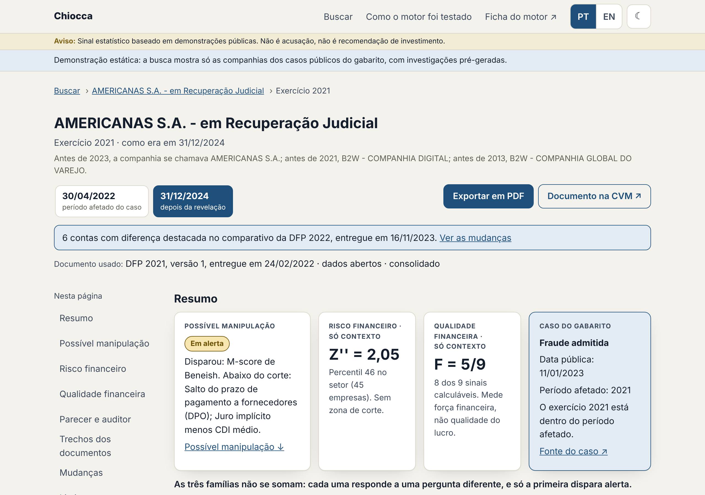
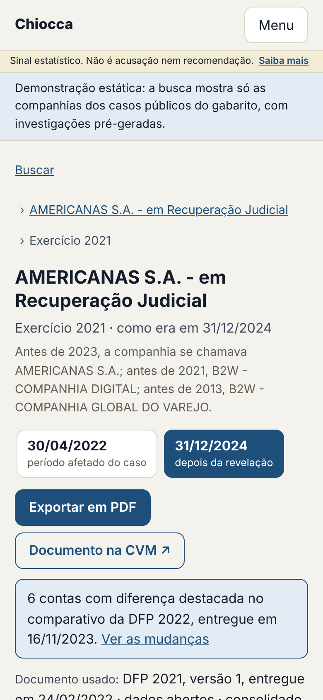

<div align="center">

# Chiocca System

**Alertas de manipulação contábil em companhias abertas brasileiras, calculados só com o que era público na época.**

[English](README.en.md) · [Demonstração](https://robertochiocca.github.io/Chiocca-System-/)

</div>

> **Alerta, não acusação.** Projeto de estudo e portfólio: o sistema emite alertas estatísticos a partir de demonstrações públicas e não é recomendação de investimento. Um alerta diz onde olhar, não que houve fraude.

## Em 30 segundos

O Chiocca System calcula sinais de manipulação contábil (o M-score de Beneish e sinais adaptados ao Brasil) para as companhias abertas brasileiras, com os dados abertos da CVM.
Cada cálculo usa só a versão da demonstração que era pública na data, e as regras de alerta foram fixadas antes de olhar os dados.
Para uma companhia e uma data, o produto mostra a investigação como era naquela data, com a origem de cada número.

<p> </p>

**Estudo 1 (2010 a 2023), com as regras fixadas antes dos dados:** o motor acertou 7 de 13 casos acertáveis, o que não supera o acaso (7,37 esperados, num cálculo feito depois do resultado); alertou 49,9% das empresa-anos não financeiras avaliadas; e, no período inteiro, deu 108,3 alarmes por acerto, contra 26,8 da regra boba de comparação (alertar os 10% mais endividados de cada ano, dentro de cada grupo), que acertou 6 ([resultados](docs/resultados.md)).

**Estudo 2 (2024 e 2025):** o mesmo motor, sem nenhuma mudança, testado para frente. A lista foi lacrada em 21/11/2026, e só o SHA-256 dela é público, carimbado no Bitcoin pelo OpenTimestamps; avaliação secundária a partir de 31/05/2027 e principal a partir de 01/01/2030 ([pré-registro](docs/pre-registro-estudo-2.md)).

**Stack:** Python 3.12+ (pandas, DuckDB sobre Parquet, FastAPI), Next.js com TypeScript e GitHub Actions; dados abertos da CVM e do Banco Central.

**Demonstração:** [robertochiocca.github.io/Chiocca-System-](https://robertochiocca.github.io/Chiocca-System-/).

## O problema

A base de dados abertos da CVM é atualizada quando uma empresa reapresenta suas demonstrações. Quem baixa hoje o balanço de 2021 da Americanas recebe o número corrigido: o lucro de R$ 544 milhões virou prejuízo de R$ 6,2 bilhões na reapresentação. Testar um detector com o número corrigido é "prever" a fraude olhando a resposta. Aqui, cada cálculo usa só a versão que era pública na data de corte, e a pergunta é: sinais simples teriam alertado para casos reais antes de eles virem a público, e a que custo em alarmes falsos?

## Demonstração

[https://robertochiocca.github.io/Chiocca-System-/](https://robertochiocca.github.io/Chiocca-System-/) é um site estático, sem API, com as investigações geradas antes pelo próprio produto: as 32 companhias do gabarito que entram no modo demonstração, em datas fixas (a data de corte de cada exercício do período afetado, a do exercício anterior e 31/12/2024), em PT e EN, com o PDF. A busca é só por nome, código CVM ou CNPJ. Não mostra outras companhias, outras datas nem exercícios de 2024 em diante, reservados ao estudo 2.

## Sinais da primeira versão

M-score de Beneish (oito índices que comparam um ano com o anterior), salto no prazo de fornecedores (o mecanismo do risco sacado na Americanas), juro implícito alto demais para a dívida declarada, lucro que não vira caixa e, só nas financeiras, peso de ganhos não recorrentes. Fórmulas, contas da DFP e referências estão em [`catalogo_sinais.yaml`](catalogo_sinais.yaml), a fonte única dos sinais. O lucro que não vira caixa aparece na ficha, mas não dispara alerta sozinho: ele já entra no M-score pelo TATA ([pré-registro do estudo 1](docs/pre-registro.md), seção 4).

## Estado do projeto

### Correção do software

Os testes automáticos (pytest) rodam no CI em Python 3.12 e 3.13. O invariante reproduz o estudo 1 a partir do armazém temporal: 9.474 de 9.474 empresa-anos iguais ao estudo, coluna por coluna ([armazenamento temporal](docs/armazenamento-temporal.md)). O exemplo resolvido confere cada fórmula contra valores calculados à mão (`data/exemplo_resolvido.json`), e as conferências de qualidade testam os próprios dados da CVM ([conferências](docs/conferencias.md)). Isso mostra que o software calcula o que o pré-registro manda e reproduz o estudo 1.

### Efetividade da detecção

No estudo 1, o motor acertou 7 de 13 casos acertáveis, com 108,3 alarmes por acerto no período inteiro e taxa de alerta de 49,9% das empresa-anos não financeiras avaliadas ([resumo](docs/resumo.md)). A [ficha do motor](docs/ficha-do-motor.md) reúne esses números, o teste contra o acaso, o uso pretendido e o que fica fora de escopo.

**Depois do resultado (análise descritiva, não pré-registrada).** Com anos independentes, o acaso daria 8,56 acertos em média, e 7 ou mais com chance de 90,0%. Como os alertas se repetem na mesma empresa (73,8% das empresa-anos em alerta das não financeiras também estavam em alerta no ano anterior, contra taxa de alerta de 49,9% das empresa-anos não financeiras avaliadas), esse número é um teto. Com a chance de cada caso medida nas empresas do mesmo grupo, sem supor anos independentes, o acaso daria 7,37 acertos, e 7 ou mais com chance de 69,3%. Detalhes em [`docs/analises-pos-estudo-1.md`](docs/analises-pos-estudo-1.md).

Uma coisa não prova a outra: o software estar correto não faz os alertas acertarem, e um acerto não mostra que o cálculo está certo. A correção é conferida pelos testes; a efetividade, só pelo estudo, com gabarito e pré-registro.

O produto (v2) e o histórico das fases, do estudo 1 à lista lacrada do estudo 2, estão em [`docs/historico.md`](docs/historico.md).

## Limitações

As limitações do estudo 1 estão no [resumo](docs/resumo.md) e nos [resultados](docs/resultados.md). As principais:

- O juro implícito responde sozinho por 59,8% das empresa-anos não financeiras em alerta (2.001 de 3.345): a despesa financeira (3.06.02) inclui variação cambial, juros de arrendamento e outros itens que não são juros dos empréstimos ([resumo](docs/resumo.md)).
- O M-score ficou sem valor em 1.548 de 6.938 empresa-anos; em 1.306, faltou o DEPI. O motivo mais comum é a DFC sem linha de depreciação na seção 6.01.01 (1.135 empresa-anos); quando a depreciação vem somada à amortização na mesma linha, o total é usado e o DEPI é calculado ([resultados](docs/resultados.md)).
- O corte de -1,78 do M-score vem de Beneish (1999), estimado com empresas dos EUA, e não foi recalibrado para o Brasil ([resumo](docs/resumo.md)).
- O IRB não pode ser acertado com DFP anual (emenda 3); pegá-lo exigiria dados trimestrais (ITR) ([resumo](docs/resumo.md)).
- Poucos casos: 13 acertáveis em 42 no gabarito, nenhum deles financeiro ([resumo](docs/resumo.md)).
- O número de acertos não superou o acaso no teste descritivo feito depois do resultado: 7 acertos, contra 7,37 esperados sem supor anos independentes (8,56 supondo anos independentes) ([análise](docs/analises-pos-estudo-1.md)).
- Versões antigas recuperadas pelo ENET só existem para demonstrações consolidadas: de 2010 a 2023, 190 empresa-anos com a versão da época só em demonstração individual ficaram de fora (emenda 8) ([armazenamento temporal](docs/armazenamento-temporal.md)).
- Depois do resultado, as conferências acharam 57 empresa-anos em que um balanço não preenchido entrou no cálculo como zero; 29 alertas dependem disso. Nenhum caso do gabarito foi afetado. Detalhes na [nota posterior](docs/analises-pos-estudo-1.md), seção 4.

## Princípios

Como era na época (nenhum cálculo usa informação posterior à data de corte); pré-registro assinado antes dos dados ([`docs/pre-registro.md`](docs/pre-registro.md)); nenhum número digitado à mão; nenhuma lista de empresas em alerta é divulgada, só números agregados e os casos do gabarito, que já são públicos; resultado ruim também é resultado; PT e EN com os mesmos números, testados.

## Como rodar

```
python -m pip install -r requirements-lock.txt && python -m pip install -e . --no-deps
python -m pytest                      # testes sem rede
```

Para ver a demonstração no computador, `make demo` (Node.js 22 ou mais): serve a interface em `http://127.0.0.1:3000/` com os exemplos versionados em `docs/exemplos/` (Americanas, exercício 2021, em 30/04/2022 e em 31/12/2024), sem baixar nada da CVM e sem API. A demonstração completa está no link do topo.

O invariante do estudo 1 (9.474 de 9.474 empresa-anos iguais ao estudo) roda localmente, com os dados da CVM em `data/brutos` e o armazém montado por `python -m chiocca.v2.armazem`. O CI não tem esses dados e pula 9 testes: 5 dependem do armazém (o invariante de 2021 e a regeneração dos 4 exemplos de `docs/exemplos/`) e 4 são valores da fase 2 do teste de referência, que ficam para depois.

Os comandos completos (download da CVM, base, sinais, API, interface e demonstração estática) e a estrutura do repositório estão em [`docs/como-reproduzir.md`](docs/como-reproduzir.md). Além do branch de desenvolvimento, há os branches gerados `gh-pages` (o site da demonstração) e `estudo-2-dados` (os arquivos da CVM usados no estudo 2); para clonar só o código, `git clone --single-branch --branch main <endereço do repositório>`.

## Como este projeto foi feito

Concebido, especificado e revisado por Roberto Chiocca, de quem são a pergunta, a metodologia e as decisões dos estudos. O código foi escrito com assistentes de IA para programação, por fases, com parada para revisão antes de cada fase. O exemplo resolvido foi calculado por um script separado, escrito antes do motor, e os módulos reaproveitados de outros projetos têm a origem em [`docs/origem-do-codigo.md`](docs/origem-do-codigo.md).

## Referências

Beneish (1999), *The Detection of Earnings Manipulation*; Beneish, Lee e Nichols (2013); Dechow, Ge, Larson e Sloan (2011); Schilit, Perler e Engelhart (2018), *Financial Shenanigans*; Bao et al. (2020). Lista completa, com páginas, DOI e licença: [`docs/referencias.md`](docs/referencias.md).
